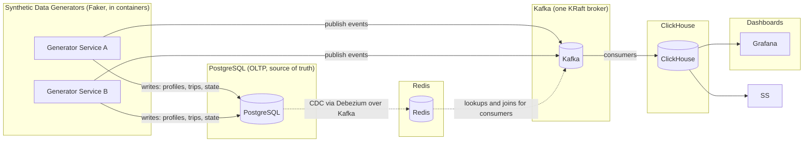
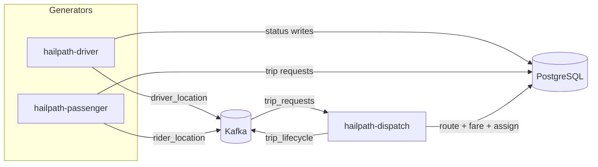
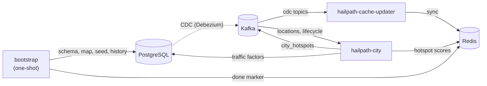
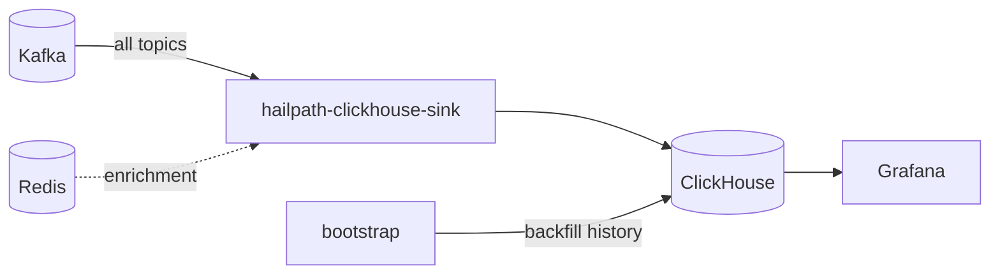
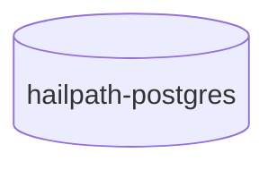
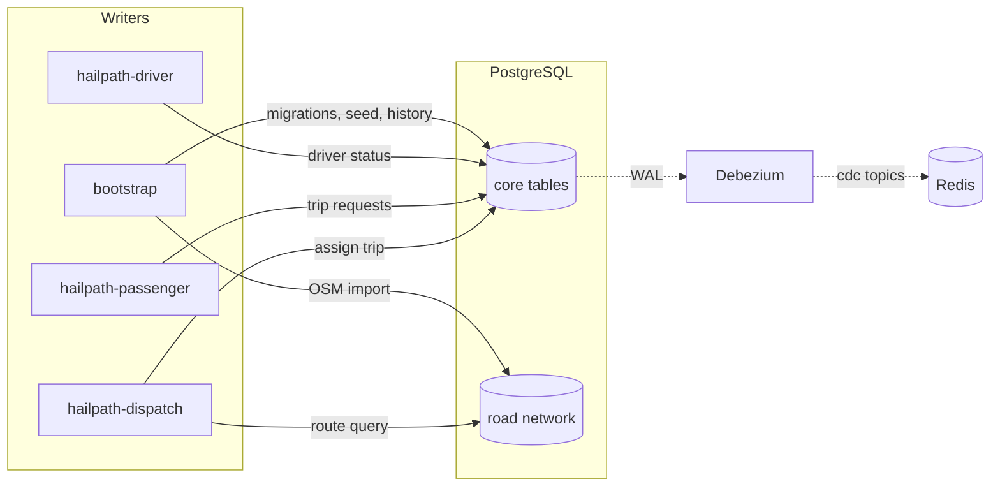
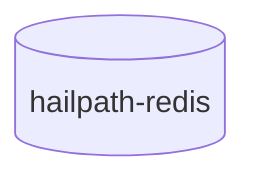
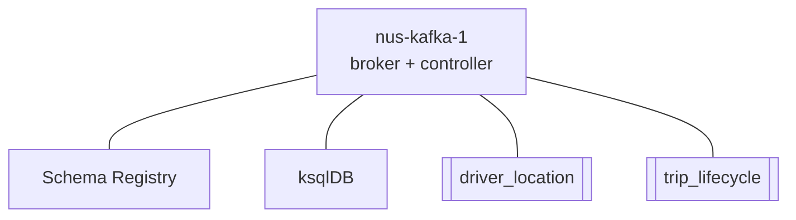
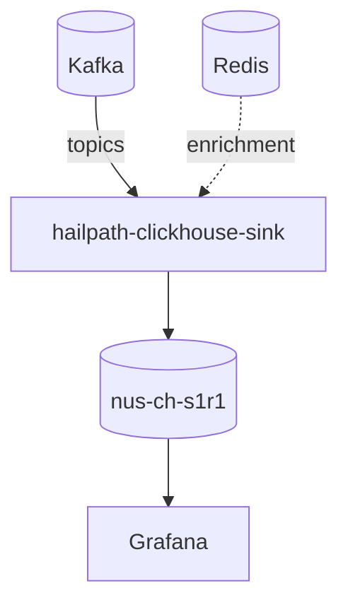

# Meanul Data Studio

Assessment contract: [ASSESSMENT.md](ASSESSMENT.md). Studio-wide bars for
schema, the message broker, cache, data generation, and simulation apply
to every version in this repository. Version 1 (`meanul-hailpath`) binds
those bars to named Makefile targets and domain measurements in the same
file. Later versions add a profile; they do not replace the file.

## 1. About Meanul Data Studio

Meanul Data Studio is a framework for simulating the **full backend data
lifecycle of an online platform**, end to end, packaged as a set of Docker
containers and run via a single `docker-compose.yaml` on a single host.

Each "version" of the studio applies the same architectural pattern to a
different product domain — for example a cab/ride-hailing platform, a
music/video streaming platform (Spotify/Netflix-like), a flight-booking /
airport platform, and so on. The studio is designed to host **multiple such
versions over time**; the pattern itself is domain-agnostic:

- **Synthetic data generation** — All activity (users, drivers, listeners,
  trips, plays, bookings, etc.) is produced by services built with the
  [Faker](https://faker.readthedocs.io/) library, generating realistic,
  internally-consistent records rather than arbitrary random values.
  Generation pacing (volume, rate, time-of-day/weekday/seasonal weighting)
  is config-driven.
- **OLTP layer (PostgreSQL)** — The single source of truth for operational
  state (e.g. driver/passenger/trip tables): a solid, transactional
  database that generators write to. Semi-structured / JSON-like payloads
  are stored natively in PostgreSQL **`JSONB`** columns — no separate
  document database (e.g. MongoDB) is introduced for them.
- **Cache layer (one Redis)** — Sits in front of the OLTP layer as the
  **read path for everything else**. ClickHouse-feeding consumers and
  other mimic services must never query PostgreSQL directly for
  joins/lookups — they read from Redis instead. When data in PostgreSQL
  changes, the change is captured via **CDC (Debezium over Kafka)** and
  applied to the cache, keeping Redis consistent with the source of truth.
- **Streaming backbone (one Kafka broker, KRaft mode)** — One broker that
  is also its own controller (no ZooKeeper). Generators and the OLTP
  layer publish **binary Avro** events onto Kafka topics, with schemas
  managed by a schema registry. Partitions stay, so one key still orders
  on one partition. A SQL client reads the broker through ksqlDB.
- **OLAP layer (one ClickHouse)** — One MergeTree server fed from Kafka.
  The names Grafana queries are the tables.
- **Dashboards** — [Grafana](https://grafana.com/), the only front end,
  backed by ClickHouse. It serves both the live/operational views and the
  analytical ones.

Every component, including the Python generator services, runs inside its
own Docker container — there is no host-level virtual environment; any
Python `venv`s live entirely inside the container images.



## 2. Version 1 — Cab / Ride-Hailing Platform

Version 1 simulates an online cab/ride-hailing platform: drivers and
passengers, trip requests, real-time location streaming during a trip, real
routes over the NYC street network, dynamic demand "hotspots", and the
analytics built on top of all of the above.

### 2.1 Services

The platform is split into one **one-shot init service** and several
**long-running services**, each its own container:

| Service | Type | Responsibility |
| --- | --- | --- |
| `hailpath-bootstrap` | one-shot | `make bootstrap`: migrations, restore the LION graph with the pgRouting image, seed people and a week of history into PostgreSQL and ClickHouse, then set `system:bootstrap:done` in Redis. The live services wait on that marker. |
| `hailpath-driver` | long-running | Simulates the pool of active drivers (not one container per driver — one process manages many). Produces driver status and location. |
| `hailpath-passenger` | long-running | Simulates the pool of riders. Produces trip requests and rider location. |
| `hailpath-dispatch` | long-running | Matches requests to drivers, routes with pgRouting, prices the trip, and walks the offer chain. |
| `hailpath-city` | long-running | Zone demand scores and per-segment traffic used by routing. |
| `hailpath-clickhouse-sink` | long-running | Kafka topics into ClickHouse, enriched from Redis. |
| `hailpath-cache-updater` | long-running | Debezium CDC topics into Redis. |
| `hailpath-archiver` | long-running | Prunes ended trips from PostgreSQL after they are in the warehouse. |

Driver and rider telemetry are independent generators that refer to the same trips.

Naming: running processes use `hailpath-<job>` for the compose service
name, `container_name`, and hostname. Directory prefixes in
[2.8](#28-project-structure) (`j-service-driver`, ...) encode build order
only. Built images are `hailpath/<job>`. The Docker network is
`hailpath-net`. There is no HAProxy. Each store is one process; clients
use its container name. Lab host ports are published on those containers.

#### Host ports (lab)

Each store publishes its own port. Production would publish Grafana (`3000`) only.

- **5432** -> `hailpath-postgres`. Debezium uses this port;
- **6379** -> `hailpath-redis`;
- **9094** -> `hailpath-kafka`;
- **8089** -> ksqlDB;
- **8123 / 9000** -> `hailpath-clickhouse` (HTTP / native);
- **3000** -> Grafana;
- **8080** -> `hailpath-tiles`.

#### Trip lifecycle & fares

Every trip walks a status machine, and terminal outcomes are drawn from
config-driven weights:

```
requested -> matched -> accepted -> en_route_pickup -> in_progress -> completed
```

Terminal alternatives at the appropriate stages: `cancelled_by_passenger`,
`cancelled_by_driver`, `no_driver_found` — defaults: ~70% `completed` and
~30% spread across the three, all tunable in the pacing config.

Fares implement **surge pricing**, closing the loop with the hotspot
system:

- **Estimate at assignment**:
  `fare_estimate = (base_fare + per_km * route_km + per_min * predicted_min) * surge`,
  where `surge` is derived from the pickup zone's `hotspot:{zone}:{period}`
  score at request time.
- **Final fare at completion** recomputes the time component from the
  actual duration.
- The estimate, the final fare, and the surge multiplier used are all
  stored on the trip and flow into ClickHouse for revenue/surge analytics.

#### Container startup procedure

`docker-compose up` brings the stack up in a strict order, enforced through
healthchecks and `depends_on: condition: service_healthy`:

1. **Infrastructure** starts first: one PostgreSQL, one Redis, one Kafka
   broker with Schema Registry and ksqlDB, Debezium Connect, one ClickHouse,
   Grafana — each with a healthcheck.
2. **Long-running app services** (`driver-service`, `passenger-service`,
   `dispatch-service`, `city-service`, `clickhouse-sink`, `cache-updater`)
   start once the infrastructure they depend on is healthy, and wait in
   standby until the data layer is initialized.
3. **`bootstrap` is the last container to come up**, gated on every other
   service being healthy. It runs migrations, downloads the NYC OSM extract
   (skipped if already cached on its volume), builds the pgRouting
   topology, seeds reference data plus one week of historical mock activity
   (including per-segment traffic baselines), bulk-loads that week into
   ClickHouse, then — as its final act — sets the `system:bootstrap:done`
   marker key in Redis and exits successfully. During this phase the stack
   may briefly approach the server memory ceiling (see
   [2.9](#29-resource-allocation)).
4. The standby app services poll `system:bootstrap:done`; once it appears
   they begin generating live activity, and from this point the whole
   ecosystem runs purely from its configuration. The cache needs no
   explicit preload — Debezium replays the seeded rows from the WAL and
   `cache-updater`'s idempotent upserts fill Redis.

### 2.2 High-level overview (HLD)

The overview is split into three small diagrams — write path, feedback
loops, and analytics path — so each stays readable.

**Write path (live activity):**



**Feedback loops (cache sync, hotspots, init):**



(Services read profiles, active trips, hotspot scores, and the driver geo
index from Redis — never from PostgreSQL directly.)

**Analytics path:**



### 2.3 PostgreSQL (HLD)

PostgreSQL is the system of truth for all transactional/operational state
and the NYC road network graph. It is one process, `hailpath-postgres`. The
PostgreSQL layer relies on three pillars:

- **[PostGIS](https://postgis.net/)** — the extension that stores the NYC
  map: road geometries, pickup/drop-off points, and route linestrings live
  in `geometry` columns with GiST spatial indexes.
- **[pgRouting](https://pgrouting.org/)** — the extension that turns the
  map into a routable graph and finds the best path for each trip
  (see [2.7](#27-nyc-road-network--routing) for the traffic-aware cost
  model).
- **`JSONB`** — all JSON-like / semi-structured payloads (device metadata,
  event payloads, flexible trip attributes) are stored in native `JSONB`
  columns with GIN indexes where needed — PostgreSQL covers the
  document-store role, so no MongoDB is part of the stack.

**Entry point:** services connect to `hailpath-postgres:5432`. Debezium uses
that port. `PG_HOST` is `hailpath-postgres`.

**Migrations** are plain, ordered SQL files
(`h-bootstrap/migrations/001_*.sql`, `002_*.sql`, ...) applied exactly once
by `bootstrap` — no migration framework is needed for a one-shot init.





Core tables (conceptual):

- `drivers` — driver profile + current status (offline/idle/en-route/on-trip);
  device/vehicle metadata in `JSONB`.
- `passengers` — passenger/rider profile; preferences/device metadata in
  `JSONB`.
- `trips` — pickup point, drop-off point (PostGIS points), assigned driver,
  computed route geometry (PostGIS linestring), predicted duration, status
  (lifecycle in [2.1](#21-services)), fare estimate / final fare / surge
  multiplier, timestamps; flexible attributes in `JSONB`.
- `city_zones` — NYC zone/grid definitions used for hotspot aggregation.
- `segment_traffic` — per-road-segment congestion factors: baseline from the
  bootstrap-seeded historical week, continuously refreshed by `city-service`
  from live streams; consumed by pgRouting as edge-cost multipliers.
- `ways` / `ways_vertices_pgr` — pgRouting topology built from the NYC OSM
  extract (see [2.7](#27-nyc-road-network--routing)).

> **Note:** this table list is a conceptual demonstration only. The final
> schema is settled during development against the running PostgreSQL —
> additional tables may well be added along the way.

### 2.4 Redis (HLD)

One Redis, `hailpath-redis`, is the **only** read path for cached reference
and hot-path data — generators, dispatch, the city service, and the
ClickHouse sink read from here, never directly from PostgreSQL.
`make verify-redis` is a PING.



Key spaces (conceptual):

| Key pattern | Written by | Read by | Notes |
| --- | --- | --- | --- |
| `driver:{id}` | `cache-updater` (CDC) | `driver-service`, `dispatch-service`, `clickhouse-sink` | profile + current status |
| `passenger:{id}` | `cache-updater` (CDC) | `passenger-service`, `dispatch-service`, `clickhouse-sink` | profile |
| `trip:{id}:active` | `dispatch-service` | `driver-service`, `passenger-service`, `clickhouse-sink` | active-trip state incl. route + predicted duration |
| `geo:drivers:available` | `driver-service` | `dispatch-service` | Redis GEO set for nearest-driver lookup |
| `hotspot:{zone}:{period}` | `city-service` | `driver-service`, `dispatch-service` (surge), `clickhouse-sink` | demand score, **TTL = 6h** (24h split into 4 periods) |
| `system:bootstrap:done` | `bootstrap` (final act) | all app services (startup poll) | readiness marker, no TTL |

`cache-updater` upserts are **idempotent (last-write-wins per key)** — the
cache is filled by Debezium's CDC replay of the bootstrap-seeded rows
rather than an explicit preload, so replays and service restarts are
harmless by construction.

> **Note:** the key spaces above are a conceptual demonstration only. The
> final key layout is settled during development against the running
> Redis — additional key spaces may well be added.

### 2.5 Kafka (HLD)

Kafka is one broker in **KRaft mode** (broker and controller, no
ZooKeeper). All events are encoded as **binary Avro**: a **Schema
Registry** container holds every topic's schema, producers
register/resolve schemas at startup, and consumers fetch them by the
schema id embedded in each message. Debezium Connect uses its Avro
converter, so the `cdc.*` topics share the same encoding. Declared topics
are created with **replication factor 1** and `min.insync.replicas=1`.
Partitions stay, so a key still orders on one partition. **ksqlDB** is
how a SQL client reads this broker. Its own topics are also one replica.

Binary does **not** mean unreadable — every topic stays inspectable and
queryable (the concrete recipes live in `c-infra-kafka/`'s docs):

- **Live tail, decoded to JSON**:
  `kcat -s avro -r http://schema-registry:8081` or
  `kafka-avro-console-consumer` decode messages on the fly through the
  Schema Registry.
- **SQL directly over a live topic**: ksqlDB (host port 8089) answers
  `SELECT` against the streams in `c-infra-kafka/ksql/`. ClickHouse's
  Kafka table engine can also read topics with `format = 'AvroConfluent'`
  and `format_avro_schema_registry_url`.
- **SQL over the full history**: `clickhouse-sink` lands every event in
  ClickHouse anyway, so anything that ever passed through Kafka is one
  query away in `clickhouse-client` or Grafana.



| Topic | Partitions | Producer | Consumer(s) |
| --- | --- | --- | --- |
| `driver_location` | 12 | `driver-service` | `city-service`, `clickhouse-sink` |
| `rider_location` | 12 | `passenger-service` | `city-service`, `clickhouse-sink` |
| `trip_requests` | 6 | `passenger-service` | `dispatch-service`, `clickhouse-sink` |
| `trip_lifecycle` | 6 | `dispatch-service` | `city-service`, `clickhouse-sink` |
| `dispatch_offers` | 6 | `dispatch-service` | `clickhouse-sink` |
| `city_hotspots` | 3 | `city-service` | `clickhouse-sink` |
| `segment_traffic_updates` | 3 | `city-service` | `clickhouse-sink` |
| `cdc.*` (per table) | 3 | Debezium Connect (from PostgreSQL WAL) | `cache-updater` |

The source of those partition counts is `c-infra-kafka/topics/topics.tsv`.
Each topic has a key, so one entity stays on one partition. Replication
factor is 1.

> **Note:** Debezium creates the `cdc.*` topics. They are not in the TSV.

### 2.6 ClickHouse (HLD)

ClickHouse is one server, `hailpath-clickhouse`. `clickhouse-sink` consumes the
Kafka topics above and writes the warehouse tables that back Grafana,
which serves both the live/ops and the analytical views. The names those
dashboards query
(`hailpath.trip_events`, `hailpath.driver_positions`, and the rest) are the tables.
Engines are `MergeTree`, `SummingMergeTree`, `AggregatingMergeTree`, or
`ReplacingMergeTree`. A second copy on this host would not be a second
machine. See
`meanul-hailpath/e-infra-clickhouse/clickhouse-design.md`.

**Relationship with Redis:** before inserting, the sink enriches events
using Redis — for example, when a completed trip arrives it looks up
`hotspot:{zone}:{period}` to mark whether it was a **hotspot trip**, and
compares the actual duration against the predicted duration cached on
`trip:{id}:active` to flag trips that **took longer than predicted**.
This keeps those lookups off PostgreSQL, per the cache-first rule in
Section 1.

**Client entry point:** `clickhouse-sink` and Grafana reach
the server on 8123 (HTTP) and 9000 (native). Both ports are
`hailpath-clickhouse`. `bootstrap` loads history here
so dashboards have rows after init. Grafana uses the ClickHouse
datasource plugin.



### 2.7 NYC road network & routing

The PostgreSQL OLTP database holds the NYC street network as a routable
graph, used to compute a real route (pickup -> drop-off) for every trip.
The map is stored by the **PostGIS** extension and routed by the
**pgRouting** extension:

- **Source data**: an OpenStreetMap extract for New York City (e.g. via
  Geofabrik or the OSM Overpass API), which provides accurate, freely
  licensed street geometry and metadata for the full road network.
- **Loading**: the `bootstrap` service downloads the extract onto a named
  volume — **the download is skipped entirely when the file is already
  present and checksum-valid**, so repeated `docker-compose up` runs never
  re-fetch it — then imports it into PostgreSQL/**PostGIS** and converts it
  into a routable topology using `osm2pgrouting` (or `osm2pgsql` +
  pgRouting's topology functions), producing the standard pgRouting
  `ways` / `ways_vertices_pgr` tables.
- **Traffic-aware best path**: routing does not use raw geometric distance
  alone. Each road segment's cost is its base travel time (length /
  segment speed) multiplied by a **congestion factor** from the
  `segment_traffic` table. The baseline factors come from the week of
  historical activity seeded by `bootstrap`; from then on `city-service`
  continuously recomputes them from the live `driver_location` /
  `rider_location` streams. The same trip can therefore get a different
  "best" route at rush hour than at 3 AM.
- **Routing**: for each trip, `dispatch-service` calls pgRouting
  (`pgr_dijkstra` or `pgr_astar`) with the traffic-weighted edge costs to
  compute the best path between the pickup and drop-off vertices; the
  resulting route geometry (PostGIS linestring) and predicted duration are
  stored on the trip record. The predicted duration is what the
  `clickhouse-sink` later compares against actual duration to flag
  overrunning trips.
- **Indexing**: spatial indexes (GiST on geometry columns) and pgRouting's
  vertex/edge indexes are applied so route lookups remain fast as trip
  volume grows.
- **Simulation clock & timezones**: the bootstrap-seeded week carries real
  past timestamps (now − 7 days ... now); live services run on the wall
  clock. The timezone policy is explicit and stack-wide: **every container
  runs with `TZ=UTC`** (set via each `.env`), PostgreSQL pins `timezone`
  and `log_timezone` to UTC, and all stored timestamps are UTC. The single
  deliberate exception is the pacing config, interpreted in NYC local time
  (`SIM_TIMEZONE=America/New_York`) — rush hour means NYC rush hour.

### 2.8 Project structure

Each product lives in its own top-level directory:

- `meanul-hailpath/` — NYC rides. This is the running project.
- `meanul-vaultscan/` — Payments, scanned for fraud. Placeholder.
- `meanul-skybound/` — Flights on a world map. Placeholder.
- `meanul-nightcast/` — Video catalog. Placeholder.

**Modular compose:** every component directory ships its own
`docker-compose.yaml` defining just its containers, volumes, and networks;
the root `meanul-hailpath/docker-compose.yaml` stitches the full stack
together with Compose's `include:` directive. Each component can therefore
be brought up and tested **in isolation** (`docker compose up` inside its
directory) — exactly matching the build/test order below — while the root
file still provides the single-command full-stack deployment.

Every component lives directly under `meanul-hailpath/` (no `infra/` or
`services/` grouping) and is named
`<letter>-infra-<name>` or `<letter>-service-<name>`, where the letter
encodes a single **alphabetic build/test-order** (`a-`, `b-`, `c-`, ...)
across the whole stack — sorting the directory alphabetically shows
exactly the order each piece should be written and tested in. **All
infrastructure directories (`infra-*`) come first, as a block, since they are
the foundation every service is built on; `bootstrap` and the app services
(`service-*`) follow.** Each component's own design notes live inside its
own directory. Generated schema docs live in `z-docs/`. Makefile fragments live in
`z-mk/`. Both sit after the services, with `z-config/` and `z-lib/`. See
[2.8.1](#281-build--test-order) for the dependency reasoning behind the
sequence.

```
meanul-data-studio/
├── README.md
├── LICENSE
├── .gitignore
└── meanul-hailpath/                 # Version 1 — cab / ride-hailing platform
    ├── README.md                     # step-by-step runbook for bringing the stack up
    ├── Makefile                      # the runbook, executable: make help / init / preflight / up / verify
    ├── docker-compose.yaml           # root file: include of every component compose
    ├── .env.example                  # template for the untracked .env — the MASTER settings file
    │                                 #   for the whole stack (every include resolves from it)
    ├── a-infra-postgres/             # one PostgreSQL (PostGIS, pgRouting)
    │   └── docker-compose.yaml       # component compose (every component dir has one)
    ├── b-infra-redis/                # one Redis
    ├── c-infra-kafka/                # one KRaft broker, Schema Registry, ksqlDB, Avro schemas
    ├── d-infra-debezium/             # Kafka Connect + Avro converter, PostgreSQL CDC connector
    ├── e-infra-clickhouse/           # one ClickHouse, table DDL, clickhouse-design.md
    ├── f-infra-grafana/              # provisioned ClickHouse datasource + live dashboard
    ├── h-bootstrap/                  # one-shot init service (starts last, runs once, exits)
    │   ├── bootstrap/                # the stages: migrate, osm, zones, people, history, warehouse
    │   └── migrations/               # SQL schema migrations, applied once in name order
    ├── i-service-cache-updater/      # cdc.* topics -> Redis, the loop that keeps the cache honest
    ├── j-service-driver/             # one container, many simulated drivers
    ├── k-service-passenger/          # riders asking for trips
    ├── l-service-dispatch/           # matching, pgRouting, surge pricing, trip status
    ├── m-service-city/               # demand scores per zone, live traffic factors
    ├── n-service-clickhouse-sink/    # every event into ClickHouse, enriched from Redis
    ├── o-service-archiver/           # prune ended trips from PostgreSQL
    ├── z-config/                     # stack-level config (sorts last on purpose)
    ├── z-docs/                       # generated schema dictionary and ERD
    ├── z-lib/                        # shared Python code
    │   └── hailpath-common/               # clients, logging, lifecycle used by h- and every service
    └── z-mk/                         # Makefile fragments included by the root Makefile
```

**Toolchain:** every Python component (`h-bootstrap` and the six
`*-service-*` directories) targets **Python 3.13** (the latest
long-support release) with **[uv](https://docs.astral.sh/uv/)** as the
dependency manager — each component carries its own `pyproject.toml` +
`uv.lock` and a multi-stage Dockerfile (`uv sync` in the build stage, slim
runtime stage; no venv ever touches the host). What all seven have in
common — reading settings, JSON logging, clean shutdown, and the clients for
PostgreSQL, Redis, Kafka and ClickHouse — lives once in `z-lib/hailpath-common`
and is pulled in as a path dependency; their build context is
`meanul-hailpath/` so the image holds the same layout as the repository.
There is no stack-wide proxy. Lab host ports are published on each store.
The Schema Registry config lives in `c-infra-kafka/`.

#### 2.8.1 Build & test order

Infrastructure is provisioned first as a block (`a-` to `g-`), since every
service depends on some part of it; `bootstrap` and the app services
(`h-` to `n-`) follow in dependency order, so each piece can be written and
tested in isolation before the next depends on it:

| Step | Component | Why this point in the sequence |
| --- | --- | --- |
| `a-` | `a-infra-postgres` | Foundation: schema, PostGIS/pgRouting — testable standalone with raw SQL. |
| `b-` | `b-infra-redis` | One Redis — testable standalone (PING, set/get). |
| `c-` | `c-infra-kafka` | One broker, Schema Registry, ksqlDB — testable standalone before any producer exists. |
| `d-` | `d-infra-debezium` | Needs `a` + `c`: CDC connector turning Postgres WAL into Kafka `cdc.*` topics. |
| `e-` | `e-infra-clickhouse` | One ClickHouse — testable standalone (DDL, inserts); the design note says why it is one process. |
| `f-` | `f-infra-grafana` | Datasource/provisioning against `e`; dashboards populate once services produce data. |
| `h-` | `h-bootstrap` | Needs `a` + `b` running: migrations, OSM import/topology build, seed data, historical week, cache preload. |
| `i-` | `i-service-cache-updater` | Needs `b` + `d`: consumes `cdc.*`, proves the cache-sync loop end-to-end. |
| `j-` | `j-service-driver` | Needs `a`, `b`, `c`, `i`: first activity generator — profiles, status, location stream. |
| `k-` | `k-service-passenger` | Same dependencies as `j`; built second since dispatch needs both. |
| `l-` | `l-service-dispatch` | Needs `j` + `k`: matching, pgRouting route calc, trip assignment. |
| `m-` | `m-service-city` | Needs `c` + `b` (and benefits from `n` for validation): hotspot scoring, traffic factors. |
| `n-` | `n-service-clickhouse-sink` | Needs `c`, `b`, `e`: Kafka -> Redis-enriched -> ClickHouse — last, since it depends on data from `j`-`m`. |

### 2.9 Resource allocation

The stack targets a dedicated Docker server with **20 CPU cores, 120 GB
RAM, and NVMe storage**. Each store is one process. The figures below are
container ceilings from `meanul-hailpath/.env.example` (tiles uses the
compose default, because that file does not set `TILES_*`). A ceiling is
not a reserved core. The CPU ceilings sum above 20. A process uses what
its work needs, up to its cap.

Resource limits are declared directly in each component's Compose file.
Explicit limits are mandatory: the JVM-based components (Kafka, Debezium
Connect) and ClickHouse will otherwise size themselves against all visible
host RAM.

The stack is brought up through the Makefile in `meanul-hailpath/`:

```bash
make up
```

which runs the preflight and then every piece in dependency order, with the
one-shots at the points where they belong. The root compose file includes
each component compose file. Each service sets `cpus`, `mem_limit`, and
`memswap_limit`, with
`memswap_limit` equal to `mem_limit` so no container can swap.

Whether the budget holds is observable rather than hoped for: `make stats`
shows live usage against each limit, `make errors` reports anything killed for
memory or restart-looping, and `make lag` reports consumer lag.

Two assumptions keep the budget realistic: generation pacing is configured
for **moderate volumes** (this is a simulation, not Uber-scale traffic),
and Grafana serves a **single dashboard user**.

Storage is not expected to be the first constraint: at the default
moderate pacing, ClickHouse produces low single-digit GB per day and Kafka
retention is bounded.

| Component | Containers | CPU ceiling | Memory ceiling |
| --- | --- | --- | --- |
| PostgreSQL (`hailpath-postgres`, `shared_buffers` 768 MB) | 1 | 4 | 3 GB |
| Redis (`hailpath-redis`, `maxmemory` 384 MB) | 1 | 0.5 | 640 MB |
| Kafka (`hailpath-kafka`, heap 768 MB) | 1 | 1 | 1.25 GB |
| Schema Registry (heap 256 MB) | 1 | 0.2 | 448 MB |
| ksqlDB (heap 384 MB) | 1 | 0.5 | 768 MB |
| Debezium Connect (heap 384 MB) | 1 | 0.4 | 640 MB |
| ClickHouse (`hailpath-clickhouse`, server ceiling 1.2 GiB) | 1 | 1 | 2 GB |
| Grafana | 1 | 0.2 | 384 MB |
| Tiles (`hailpath-tiles`) | 1 | 0.5 | 384 MB |
| `cache-updater` | 1 | 0.5 | 448 MB |
| `driver-service` | 1 | 1 | 512 MB |
| `passenger-service` | 1 | 0.75 | 448 MB |
| `dispatch-service` | 1 | 0.5 | 320 MB |
| `city-service` | 1 | 0.5 | 320 MB |
| `clickhouse-sink` | 1 | 0.75 | 512 MB |
| `archiver-service` | 1 | 0.25 | 256 MB |
| `bootstrap` (one-shot, then it exits) | 1 | 6 | 2 GB |

Steady state is **12.31 GiB** across seventeen containers, and the
bootstrap peak is **11.56 GiB** — the seven app services have not started
yet while `bootstrap` runs, so the two numbers do not add up. Both fit a
31 GiB workstation with the OS and a browser still on it.

The CPU ceilings sum to about 13.6 on a 12-thread host, which is
deliberate: `cpus:` is a quota, not a reservation. PostgreSQL's 4-core cap
is the wall during a tick, not four cores held all day.

`PG_MEM` has a floor the simulation scale cannot lower. LION is all of New
York at any scale — 172k ways — and pgRouting reads the whole edge list
into its own memory on every call, so 3 GiB is set by the graph. The
deploy-host value is 16 GB; `.env.example` names it beside each setting.

Key tuning that makes the budget fit, and the reason each pair has to move
together: `KAFKA_HEAP_OPTS` under `KAFKA_MEM`, ClickHouse's
`max_server_memory_usage` under `CH_MEM`, PostgreSQL's `shared_buffers`
under `PG_MEM`, and Redis's `maxmemory` under `REDIS_MEM`. A container cap
lowered on its own leaves a process that believes it has room the cgroup
will not give it, and the kill lands on the container with nothing in its
log to read.

#### No-swap policy

Every service sets `memswap_limit` equal to its memory limit. Under Linux
semantics memory+swap = memory, i.e. **zero swap per container**.

The consequence is deliberate: an undersized container gets **OOM-killed
and restarted** (visible in `docker ps`/restart counts) instead of
silently swapping and dragging the whole stack down.

#### Validating that the budget is enough

The limits are hard ceilings, so "does it fit?" is observable rather than
hoped for:

- **Live usage**: `docker stats` shows per-container memory against its
  limit; anything pinned at its cap is a candidate for rebalancing.
- **OOM signals**: `docker inspect --format '{{.RestartCount}} {{.State.OOMKilled}}'`
  per container — any OOM kill means that component's limit or the pacing
  config must come down.
- **Pipeline health**: Kafka consumer-group lag (must stay bounded),
  ClickHouse ingestion delay, and `make verify` on each store.
- **Soak test**: after `bootstrap` completes, run the stack at target
  pacing for several hours and confirm all of the above stay flat. The
  pacing config is the relief valve — volumes are turned down in config,
  never by removing containers.

#### Capacity estimate at default pacing

The bottleneck is **not** Kafka or ClickHouse (at these limits they
comfortably handle thousands of messages/s and tens of thousands of
batched row inserts/s respectively). The realistic constraints are the
Python generators and, above all, **per-trip pgRouting computation** on
the NYC graph (~50–150 ms per `pgr_dijkstra`/`pgr_astar` call):

| Metric | Sustained estimate |
| --- | --- |
| Concurrent simulated drivers | ~500–1,000 |
| New trips (routed via pgRouting) | ~5–10 trips/s (~0.4–0.9 M trips/day) |
| Location events (driver + rider, every 2–5 s per device) | ~400–800 events/s (~35–70 M events/day) |
| ClickHouse ingestion (compressed, ~200 B/event) | ~1–2 GB/day |
| Kafka disk (48 h retention) | a few GB, bounded |

At ~1–2 GB/day in ClickHouse, the 1 TB disk holds **months to years** of
simulated history; ClickHouse table TTLs and Kafka retention keep growth
bounded regardless. These figures are design estimates to be confirmed by
the soak test above, and they are an order of magnitude below what the
infrastructure layers can absorb — headroom, not a cliff.

### 2.10 Showcase

_Screenshots of the running system (PostgreSQL data, Grafana dashboards,
etc.) will be added here._
